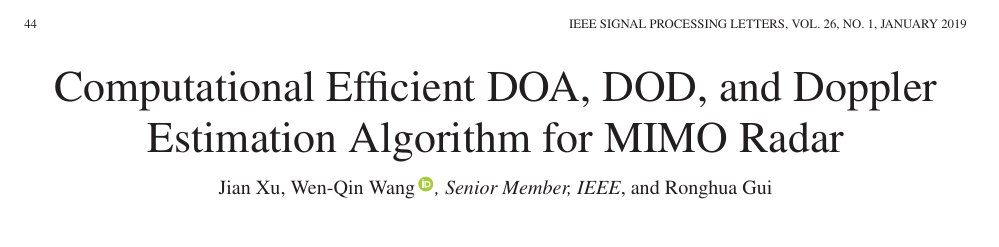
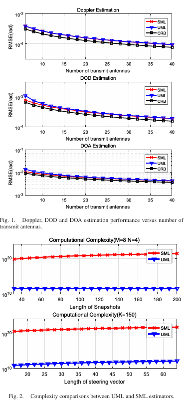

# DOA Estimation for MIMO Radar: Efficient Algorithms for DOA, DOD, and Doppler Estimation [with MATLAB Code]

Due to the high-dimensional search procedures in multi-input multi-output (MIMO) radar, the joint Doppler estimation, departure direction (DOD), and Direction of Arrival (DOA) are often too time-consuming. This paper proposes an efficient algorithm for computing the joint DOA, DOD, and Doppler estimation in MIMO radar using non-structured maximum likelihood method based on the principle of extended invariance. The algorithm estimates the Doppler, DOD, and DOA through three one-dimensional search procedures in sequence. Numerical results validate its effectiveness and superiority compared to traditional maximum likelihood algorithms.
In recent years, multi-input multi-output (MIMO) has attracted widespread attention [1]–[6], but existing target positioning algorithms that estimate multi-dimensional parameters are usually too time-consuming due to high-dimensional search procedures [7]–[9]. For example, a structured data model with explicit array response requires a two-dimensional (2D) search maximum likelihood (ML) type estimator process [10]–[12]. It is necessary to design computationally efficient algorithms [13]–[16]. Based on the principle of extended invariance (EXIP) [17], [18], if we define a one-to-one mapping between the original parameter space and the new parameter space, we can obtain asymptotically equivalent estimation values for both models. In [19], it was pointed out that a non-structured model could be reparameterized to perform unstructured ML (UML) to separately estimate DOA and Doppler.
Additionally, if considering dual-baseline MIMO radars, joint estimation of the Direction of Arrival (DOD) is also necessary [20]–[22]. Even though Doppler might be estimated independently, we still face the problem of joint estimation of DOA and DOD, which means that we still need 2D search [23] [24]. Since the joint transmission and reception control vectors of MIMO radar can be mathematically modeled as Kronecker products, and since the Kronecker product between two vectors can be reshaped because one vector multiplies by its transpose [25], we can restructure the data from dual-baseline MIMO radars. Therefore, the UML algorithm [26] can estimate DOA and DOD separately, and multidimensional estimation can achieve computational efficiency.
In this paper, we propose an efficient algorithm for joint DOA, DOD, and Doppler estimation in dual-baseline MIMO radars. In other words, we divide the 3D search required in traditional ML type estimators into three 1D searches using the UML algorithm to reduce computational complexity. Our contribution lies in extending the joint Doppler estimation with MIMO radar to both joint DOA and MIMO radar Doppler estimation, along with corresponding theoretical proofs and computational complexity analysis.
Article illustrations
Conclusion To reduce the computational complexity brought by traditional ML-type estimators in dual-baseline MIMO radars, this letter structures the data model into a non-structural one, and uses the UML algorithm to orderly estimate Doppler, DOD, and DOA. Theoretical analysis and numerical results indicate that by dividing the traditional 3D search program, significant reduction in computational complexity can be achieved through entering three 1D search programs.
Conclusion
End

## Images

<!-- PAYMENT_BLOCK -->

## Get this dataset

- Payment link (Stripe): [Buy now](https://buy.stripe.com/3cs8yP7sY87d0vu9AB)
- Payment QR code: 

<!-- /PAYMENT_BLOCK -->
